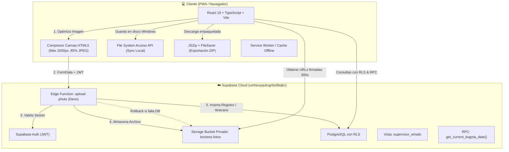

# 📸 LECTORES FOTOS — Sistema de Control y Evidencia Fotográfica

> **Aplicación Web Progresiva (PWA)** de alta disponibilidad para el registro, supervisión, trazabilidad y almacenamiento estructurado de evidencias fotográficas de medidores, asistencia diaria (**Entradas**, **Salidas**, **Apoyos**) e **Itinerarios Terminados** para cuadrillas de lectores en terreno.

---

## 📋 Tabla de Contenidos

1. [Visión General del Proyecto](#-visión-general-del-proyecto)
2. [Arquitectura Tecnológica](#-arquitectura-tecnológica)
3. [Catálogo Maestro y Modelo de Datos](#-catálogo-maestro-y-modelo-de-datos)
4. [Lógica de Negocio y Reglas Operativas](#-lógica-de-negocio-y-reglas-operativas)
5. [Módulos y Funcionalidades](#-módulos-y-funcionalidades)
   - [Panel de Autenticación y Seguridad](#1-panel-de-autenticación-y-seguridad)
   - [Dashboard de Métricas Rápidas](#2-dashboard-de-métricas-rápidas)
   - [Registro de Fotografías y Optimización](#3-registro-de-fotografías-y-optimización)
   - [Control Diario en Vivo](#4-control-diario-en-vivo)
   - [Matriz de Cobertura Mensual](#5-matriz-de-cobertura-mensual)
   - [Historial General y Exportación Dual](#6-historial-general-y-exportación-dual)
   - [PWA y Resiliencia de Conectividad](#7-pwa-y-resiliencia-de-conectividad)
6. [Estructura del Proyecto](#-estructura-del-proyecto)
7. [Variables de Entorno](#-variables-de-entorno)
8. [Instalación y Configuración](#-instalación-y-configuración)
   - [Opción A: Instalación Automatizada (PowerShell)](#opción-a-instalación-automatizada-con-powershell)
   - [Opción B: Configuración Manual Paso a Paso](#opción-b-configuración-manual-paso-a-paso)
9. [Guía de Scripts Disponibles](#-guía-de-scripts-disponibles)
10. [Políticas de Seguridad y Almacenamiento](#-políticas-de-seguridad-y-almacenamiento)
11. [Solución de Problemas Frecuentes](#-solución-de-problemas-frecuentes)

---

## 🎯 Visión General del Proyecto

**LECTORES FOTOS** surge como una solución corporativa integral para resolver el seguimiento diario y auditoría de campo de una nómina fija de **33 lectores de medidores**. 

El sistema permite que los supervisores autorizados registren la evidencia fotográfica de:
1. **Entrada**: Fotografía de inicio de jornada laboral de cada lector.
2. **Salida**: Fotografía de culminación de actividades.
3. **Apoyos**: Registro de asistencia operativa prestada por un lector a otro compañero durante el día.
4. **Itinerario Terminado**: Código identificador de ruta completada (ej. `IT-4021`).

### Principales Beneficios
* **Cero Duplicados**: Restricciones a nivel de cliente, Edge Function y base de datos (PostgreSQL partial unique indexes) impiden que se registre más de una entrada o salida por día para un mismo lector.
* **Control Horario Estricto**: Manejo absoluto de fecha y hora bajo la zona horaria oficial del negocio (**America/Bogota**), independientemente de la hora del reloj del dispositivo móvil del supervisor.
* **Optimización en Cliente**: Compresión de imágenes antes de la transferencia de red, reduciendo archivos pesados a resoluciones óptimas de 1-2 MB sin comprometer la legibilidad de los medidores.
* **Trazabilidad Total**: Cada registro almacena el supervisor responsable, fecha, hora exacta, tamaño original, tipo de foto y vínculos de apoyo.
* **Exportación y Respaldo Dual**: Descarga de lotes en archivos **ZIP organizados jerárquicamente** y sincronización nativa directa al disco duro del supervisor mediante **File System Access API**.

---

## 🏗 Arquitectura Tecnológica

La solución sigue una arquitectura desacoplada y orientada a la nube (**Jamstack + Serverless BaaS**):



### Stack Técnico
| Capa | Tecnología | Propósito |
| :--- | :--- | :--- |
| **Frontend Core** | React 19 + TypeScript (~6.0) | Interfaz reactiva y tipado estricto |
| **Bundler / Servidor Local** | Vite 8.2 | Entorno de desarrollo ultrarrápido y compilación optimizada |
| **PWA Engine** | `vite-plugin-pwa` (Workbox) | Instalabilidad standalone y capacidades offline |
| **Estilos & UI** | CSS3 Modular Moderno | Diseño Dark Glassmorphism responsivo |
| **Iconografía** | Lucide React | Iconos vectoriales ligeros |
| **Backend & Base de Datos** | Supabase (PostgreSQL 15+) | Almacenamiento relacional, RLS y Auth |
| **Computación Serverless** | Supabase Edge Functions (Deno) | Endpoint transaccional seguro con rollback |
| **Almacenamiento de Archivos**| Supabase Storage | Bucket privado con URLs firmadas temporales |
| **Exportación** | JSZip & FileSaver | Generación de archivos comprimidos cliente |
| **Acceso a Archivos Locales**| File System Access API | Escritura directa a carpetas de Windows |
| **Linter** | Oxlint | Análisis estático de código veloz |

---

## 🗄 Catálogo Maestro y Modelo de Datos

### 1. Catálogo Maestro de Lectores (33 Trabajadores)
El sistema incluye la nómina de 33 lectores registrados en la base de datos con restricción `UNIQUE`:
1. `MIGUEL DARIO VELASQUEZ PIMIENTA`
2. `JOSE ALDAIR AYOLA MEJIA`
3. `ELIAS SALIN SUAREZ GOMEZ`
4. `MEIDER DAVID MOVIL MAESTRE`
5. `ARLENSON MIGUEL BERRIO TORO`
6. `JHON JAIRO HERNANDEZ ARRIETA`
7. `FRANCISCO JAVIER PUERTA HERNANDEZ`
8. `CARLOS BONIET AREVALO IBARRA`
9. `YAFET ALEXANDER MOSCOTE ZUÑIGA`
10. `JAVIER ENRIQUEZ YEPES TORREGROZA`
11. `ZHARICK JISETH PERALTA NIEVES`
12. `ALEXIS BULA MENDOZA`
13. `SIGIFREDO BULA MENDOZA`
14. `JIMMY ENRIQUE MENDOZA MORALES`
15. `JOSE ALFONZO FUENTES DIAZ`
16. `ARNOL YAMITH REALES OÑATE`
17. `JESUS ALBERTO BULA RAMIREZ`
18. `DEIVER DE JESUS DEL VALLE BARRAZA`
19. `JAIME JAVIER MENDOZA MORALES`
20. `VICTOR FERNANDO ALVAREZ ESTRADA`
21. `NERIO LUIS BRITO PITRE`
22. `SERGIO ELIAS AMAYA TONCEL`
23. `CESAR FERNANDO LEON RODRIGUEZ`
24. `MANUEL DE JESUS MARQUEZ ARRIETA`
25. `FREDDY ENRIQUE MARQUEZ URBINA`
26. `RAFAEL DAVID FREYLL MARTINEZ`
27. `ALEXANDER RAFAEL AGUILAR DUARTE`
28. `JOSE LUIS ROSADO ROBLES`
29. `DARIO ENRIQUE SARMIENTO CORSO`
30. `ALEXIS MARTINEZ CURVELO`
31. `JAIME LUIS CHAVEZ MURGAS`
32. `YURANIS PATRICIA GARCIA NUÑEZ`
33. `YEFERSON RICARDO EPIAY IGUARAN`

---

### 2. Esquema Relacional de Base de Datos

#### A. Tabla `readers` (Catálogo de Lectores)
```sql
CREATE TABLE readers (
    id UUID PRIMARY KEY DEFAULT gen_random_uuid(),
    name VARCHAR(255) NOT NULL UNIQUE,
    created_at TIMESTAMPTZ DEFAULT NOW()
);
```

#### B. Tabla `daily_reports` (Itinerarios Diarios)
```sql
CREATE TABLE daily_reports (
    id UUID PRIMARY KEY DEFAULT gen_random_uuid(),
    reader_id UUID NOT NULL REFERENCES readers(id) ON DELETE RESTRICT,
    report_date DATE NOT NULL,
    itinerary VARCHAR(100) NOT NULL,
    created_by UUID NOT NULL REFERENCES auth.users(id),
    created_at TIMESTAMPTZ DEFAULT NOW(),
    updated_at TIMESTAMPTZ DEFAULT NOW(),
    CONSTRAINT unique_reader_report_date UNIQUE (reader_id, report_date)
);
```

#### C. Tabla `photo_records` (Evidencias Fotográficas)
```sql
CREATE TABLE photo_records (
    id UUID PRIMARY KEY DEFAULT gen_random_uuid(),
    reader_id UUID NOT NULL REFERENCES readers(id) ON DELETE RESTRICT,
    capture_date DATE NOT NULL,
    photo_type VARCHAR(10) NOT NULL CHECK (photo_type IN ('ENTRADA', 'SALIDA', 'APOYO')),
    original_name TEXT NOT NULL,
    stored_name TEXT NOT NULL,
    storage_path TEXT NOT NULL,
    uploaded_by UUID NOT NULL REFERENCES auth.users(id),
    file_size INTEGER NOT NULL,
    mime_type VARCHAR(100) NOT NULL,
    supported_reader_id UUID REFERENCES readers(id) ON DELETE RESTRICT,
    created_at TIMESTAMPTZ DEFAULT NOW()
);

-- Índices parciales únicos:
CREATE UNIQUE INDEX unique_entrance_per_day ON photo_records (reader_id, capture_date) WHERE (photo_type = 'ENTRADA');
CREATE UNIQUE INDEX unique_exit_per_day ON photo_records (reader_id, capture_date) WHERE (photo_type = 'SALIDA');
```

#### D. Vista `supervisor_emails`
Permite exponer el correo electrónico del supervisor autenticado sin exponer la tabla sensible `auth.users`:
```sql
CREATE OR REPLACE VIEW public.supervisor_emails AS
SELECT id, email FROM auth.users;
GRANT SELECT ON public.supervisor_emails TO authenticated;
```

#### E. Función RPC `get_current_bogota_date()`
Calcula la fecha de negocio oficial en Colombia (`America/Bogota`):
```sql
CREATE OR REPLACE FUNCTION get_current_bogota_date()
RETURNS DATE AS $$
BEGIN
  RETURN (CURRENT_TIMESTAMP AT TIME ZONE 'America/Bogota')::DATE;
END;
$$ LANGUAGE plpgsql;
```

---

## ⚡ Lógica de Negocio y Reglas Operativas

1. **Unicidad de Jornada**:
   - Cada lector solo puede tener **1 fotografía de ENTRADA** y **1 fotografía de SALIDA** por día calendario.
   - El formulario bloquea visualmente la opción si ya fue registrada y el servidor responde con error `409 CONFLICT` si se intenta forzar la subida.
2. **Apoyo Operativo entre Trabajadores**:
   - Un lector puede registrar múltiples fotografías de tipo `APOYO` en una misma jornada.
   - Para registrar un `APOYO`, es obligatorio especificar el **Trabajador Apoyado**.
   - El sistema valida que un trabajador **no pueda apoyarse a sí mismo** (`reader_id != supported_reader_id`).
3. **Itinerario Diario Obligatorio**:
   - Toda fotografía requiere indicar el itinerario terminado (ej. `IT-01`).
   - El itinerario se almacena mediante `UPSERT` en `daily_reports`, vinculando la última actualización a la fecha en curso.
4. **Estructura Jerárquica en Almacenamiento**:
   - Entrada: `readers/<reader_id>/<YYYY-MM-DD>/entrada.jpg`
   - Salida: `readers/<reader_id>/<YYYY-MM-DD>/salida.jpg`
   - Apoyo: `readers/<reader_id>/<YYYY-MM-DD>/apoyo/<uuid>.jpg`
5. **Transaccionalidad y Rollback**:
   - Si la subida del archivo al Storage es exitosa pero la inserción del registro en `photo_records` falla (por ejemplo por violación de restricción única concurrente), la Edge Function ejecuta inmediatamente una acción de compensación (`storage.remove`), borrando el archivo huérfano.
6. **Seguridad y Acceso Temporal**:
   - El bucket `lectores-fotos` es completamente privado. Las fotos se visualizan y descargan mediante **URLs firmadas con 5 minutos (300 segundos) de vigencia**.

---

## 🖥 Módulos y Funcionalidades

### 1. Panel de Autenticación y Seguridad
* Acceso exclusivo para supervisores registrados en Supabase Auth.
* Validación de credenciales con mensajes de error amigables en español.
* Detección automática de sesión persistente con renovación de tokens (`onAuthStateChange`).
* Banner de bloqueo amigable en caso de que falte configurar las variables del archivo `.env`.

---

### 2. Dashboard de Métricas Rápidas
Ubicado en la parte superior para seguimiento instantáneo de los KPIs del día:
* 👥 **Lectores Totales**: Conteo total del catálogo (33).
* 📥 **Entradas Registradas**: Cuántos lectores han marcado entrada hoy.
* 📤 **Salidas Registradas**: Cuántos lectores han marcado salida hoy.
* ✅ **Lectores Completos**: Trabajadores con Entrada y Salida cubiertas.
* ⏳ **Lectores Pendientes**: Trabajadores a los que les falta entrada o salida.
* 🔵 **Apoyos Realizados**: Total de apoyos operativos registrados hoy.
* 📋 **Itinerarios Hechos**: Cantidad de reportes de itinerarios radicados hoy.

---

### 3. Registro de Fotografías y Optimización
* **Selector Dinámico de Lector**: Al seleccionar un lector, se carga al instante su estado actual del día (badges de Entrada, Apoyos y Salida).
* **Precarga de Itinerario**: Si el lector ya tenía un itinerario registrado en el día, se autocompleta para evitar retrabajos.
* **Compresor Client-Side Inteligente**:
  - Utiliza HTML5 Canvas sin consumir RAM con Base64 (emplea directamente `Blob` y `File`).
  - Redimensiona proporcionalmente el lado mayor a un máximo de **2000 píxeles**.
  - Si la imagen ya pesa menos de 1.5 MB y cumple las dimensiones, no se recomprime para ahorrar tiempo de cómputo.
  - Corrige automáticamente la rotación EXIF de fotos tomadas con móviles.
* **Control de Red con Timeout**:
  - Implementa `AbortController` con un límite de **30 segundos** para evitar que peticiones en conexiones lentas queden colgadas indefinidamente.
* **Zona de Carga con Drag & Drop**: Admite arrastrar o examinar desde el explorador/cámara en formatos JPG, PNG y WEBP.

---

### 4. Control Diario en Vivo
Panel de auditoría en tiempo real para verificar el estado de los 33 lectores durante el turno:
* **Filtro de búsqueda por texto** para encontrar lectores rápidamente.
* **Diseño Responsivo Inteligente**:
  - **Escritorio**: Tabla detallada con columnas para Lector, Itinerario, Entrada, Hora, Supervisor, Apoyos, Salida, Hora, Supervisor y Botones de acción directa (`Ver E`, `Ver S`, `Ver A1...`).
  - **Móvil**: Tarjetas colapsables optimizadas para pantallas táctiles con botones rápidos para abrir la evidencia.
* **Previsualización en Modal Seguro**: Permite inspeccionar la imagen a tamaño completo con su metadata completa.

---

### 5. Matriz de Cobertura Mensual
Herramienta de supervisión a mediano plazo para auditar el cumplimiento del mes completo:
* **Navegador de Meses**: Botones de mes anterior/siguiente con cálculo de días exactos (incluyendo años bisiestos).
* **Métricas Acumuladas del Mes**: Fotos subidas, días procesados, lectores con mes completo y lectores con pendientes.
* **Vista de Escritorio (Matriz Completa)**: Cuadrícula horizontal interactiva con días 1 a 31 en columnas y los 33 lectores en filas:
  - 🟢 **Completo**: Entrada y Salida registradas.
  - 🔴 **Falta**: Días anteriores donde faltó uno o ambos registros.
  - 🟡 **Día Actual**: Jornada en curso pendiente por completar.
  - 🔵 **Apoyo (A)**: Indicador numérico de apoyos realizados en ese día.
  - ⚫ **Futuro**: Días no transcurridos.
* **Vista Móvil (Calendario Individual)**: Selector de lector con calendario mensual tipo cuadrícula semanal (L-M-M-J-V-S-D) con puntos cromáticos de estado.

---

### 6. Historial General y Exportación Dual
Módulo completo de consulta forense y extracción masiva:
* **Filtros Combinados**: Filtrado simultáneo por Lector, Fecha de Captura, Tipo de Foto y Supervisor responsable.
* **Mecanismos de Exportación**:
  1. **Descarga Masiva en ZIP**:
     - Empaqueta en memoria todas las fotografías filtradas mediante `JSZip`.
     - Genera una estructura ordenada por carpetas:
       ```
       [Nombre del Lector]/
       └── [YYYY-MM-DD]/
           ├── entrada.jpg
           ├── salida.jpg
           └── apoyo/
               └── [uuid].jpg
       ```
  2. **Sincronización a Carpeta Local (Windows / Chromium)**:
     - Utiliza la **File System Access API** (`window.showDirectoryPicker`).
     - El supervisor elige una carpeta física en su PC y la aplicación crea las subcarpetas y descarga los archivos directamente al disco, mostrando una barra de progreso en vivo.

---

### 7. PWA y Resiliencia de Conectividad
* **Instalable**: Manifiesto configurado con iconos en alta resolución (192px y 512px) y modo `standalone`.
* **Caché de Recursos**: Configuración Workbox para cargar instantáneamente hojas de estilo, scripts e iconos.
* **Monitor Offline en Tiempo Real**: Escucha eventos `online` y `offline` del navegador para suspender operaciones de subida y notificar al usuario con un banner de advertencia cuando no hay conexión.

---

## 📁 Estructura del Proyecto

```
FLUX-FOTOS-TRABAJADORES/
├── public/                       # Activos públicos estáticos y manifiesto PWA
│   ├── favicon.svg               # Icono para pestañas del navegador
│   ├── icon-192.png              # Icono PWA para dispositivos móviles (192x192)
│   ├── icon-512.png              # Icono PWA para pantallas de alta resolución (512x512)
│   ├── icons.svg                 # Hoja de iconos SVG
│   └── manifest.json             # Manifiesto Web PWA
│
├── scripts/                      # Scripts de automatización de entorno
│   └── setup.ps1                 # Asistente en PowerShell para configuración automática
│
├── scratch/                      # Scripts y consultas SQL de pruebas y soporte
│   ├── storage_policies.sql      # Políticas RLS para storage.objects
│   ├── test_history_query.js     # Script de validación de consulta relacional
│   └── test_upload.js            # Script de prueba sintética para subidas a la Edge Function
│
├── src/                          # Código fuente de la aplicación React
│   ├── assets/                   # Recursos visuales y logotipos
│   ├── components/               # Componentes modulares de interfaz
│   │   ├── DailyControl.tsx      # Tabla y tarjetas de auditoría del día
│   │   ├── DashboardStats.tsx    # Cuadrícula de tarjetas con KPIs en vivo
│   │   ├── HistoryPanel.tsx      # Panel de filtros, exportación ZIP y sync local
│   │   ├── LoginForm.tsx         # Formulario de inicio de sesión de supervisores
│   │   ├── MonthlyControl.tsx    # Matriz y calendario mensual de cobertura
│   │   └── PhotoUploadForm.tsx   # Formulario principal de captura y compresión
│   │
│   ├── services/                 # Capa de comunicación con Supabase
│   │   ├── db.ts                 # Consultas de BD, joins lógicos, RPCs y signed URLs
│   │   ├── readers.ts            # Consulta del catálogo maestro de 33 lectores
│   │   └── upload.ts             # Cliente HTTP para invocar la Edge Function con timeout
│   │
│   ├── supabase/                 # Configuración del cliente Supabase
│   │   └── client.ts             # Instancia singleton del cliente de Supabase
│   │
│   ├── types/                    # Definiciones TypeScript globales
│   │   └── index.ts              # Interfaces: Reader, PhotoRecord, DailySummary, etc.
│   │
│   ├── utils/                    # Utilidades auxiliares
│   │   └── image.ts              # Algoritmo de compresión de imágenes en Canvas
│   │
│   ├── App.css                   # Reglas de estilo auxiliares
│   ├── App.tsx                   # Componente raíz con navegación por pestañas y modal
│   ├── index.css                 # Sistema de diseño global (Dark Mode Glassmorphism)
│   └── main.tsx                  # Punto de entrada de la aplicación React
│
├── supabase/                     # Configuración y Backend de Supabase
│   ├── functions/                # Edge Functions en Deno
│   │   └── upload-photo/         # Función serverless transaccional de subida
│   │       └── index.ts          # Código de validación, almacenamiento y rollback
│   ├── schema.sql                # DDL con tablas, vistas, índices, RLS y catálogo de 33 lectores
│   └── storage_setup.sql         # Script SQL para creación del bucket privado y RLS
│
├── .env.example                  # Plantilla de variables de entorno requeridas
├── index.html                    # Plantilla HTML5 con metas PWA
├── package.json                  # Dependencias y scripts del proyecto
├── tsconfig.json                 # Configuración del compilador TypeScript
└── vite.config.ts                # Configuración de compilación de Vite y plugin PWA
```

---

## ⚙️ Variables de Entorno

Para ejecutar la aplicación es indispensable contar con el archivo `.env` en la raíz del proyecto. Puedes generarlo basándote en `.env.example`:

```env
# URL de tu instancia de Supabase
VITE_SUPABASE_URL=https://umhexyqukxgnbztlbqbc.supabase.co

# Clave pública anónima (Anon Key)
VITE_SUPABASE_ANON_KEY=sb_publishable_sg8gT9lX6w5ax6CiD2WWZw__D9jGV15

# URL directa a la Edge Function de subida
VITE_EDGE_FUNCTION_URL=https://umhexyqukxgnbztlbqbc.supabase.co/functions/v1/upload-photo
```

> [!NOTE]
> La variable `VITE_EDGE_FUNCTION_URL` es opcional si sigue la convención estándar `${VITE_SUPABASE_URL}/functions/v1/upload-photo`, pero definirla explícitamente garantiza mayor estabilidad ante reescrituras de dominio.

---

## 🚀 Instalación y Configuración

### Opción A: Instalación Automatizada con PowerShell

Si trabajas en **Windows**, el proyecto incluye un script asistido que verifica los requisitos previos, instala dependencias, configura tu archivo `.env`, vincula el proyecto de Supabase y compila el frontend.

1. Abre PowerShell en la carpeta raíz del proyecto y ejecuta:
   ```powershell
   npm run setup
   ```
2. Sigue las instrucciones interactivas en pantalla.

---

### Opción B: Configuración Manual Paso a Paso

#### 1. Instalar Dependencias de Node.js
Asegúrate de contar con Node.js 18+ o superior:
```bash
npm install
```

#### 2. Configurar la Base de Datos en Supabase
1. Ingresa a tu panel de control de Supabase: [https://supabase.com/dashboard](https://supabase.com/dashboard).
2. Selecciona tu proyecto y dirígete a **SQL Editor**.
3. Abre y ejecuta el contenido del archivo [`supabase/schema.sql`](./supabase/schema.sql). Esto creará:
   - Las tablas `readers`, `daily_reports`, `photo_records`.
   - Los índices únicos para evitar duplicados.
   - La vista de seguridad `supervisor_emails`.
   - Las políticas de Row Level Security (RLS).
   - La función RPC `get_current_bogota_date()`.
   - La inserción de los 33 lectores del catálogo maestro.

#### 3. Configurar el Almacenamiento (Storage Bucket)
En el **SQL Editor** de Supabase, ejecuta el contenido de [`supabase/storage_setup.sql`](./supabase/storage_setup.sql):
- Creará el bucket privado `lectores-fotos`.
- Aplicará las políticas RLS que permiten a los supervisores autenticados subir e inspeccionar fotografías.

#### 4. Desplegar la Edge Function
Requiere tener instalada la [Supabase CLI](https://supabase.com/docs/guides/cli):
```bash
# Iniciar sesión en Supabase CLI
supabase login

# Vincular tu proyecto
supabase link --project-ref umhexyqukxgnbztlbqbc

# Desplegar la función upload-photo
supabase functions deploy upload-photo
```

#### 5. Configurar el Archivo `.env`
Copia `.env.example` a `.env` y confirma que las claves coincidan con las de tu proyecto en Supabase (**Project Settings > API**).

#### 6. Iniciar el Servidor de Desarrollo
```bash
npm run dev
```
La aplicación quedará disponible en `http://localhost:5173`.

---

## 📜 Guía de Scripts Disponibles

En el archivo `package.json` encontrarás los siguientes comandos:

| Comando | Acción |
| :--- | :--- |
| `npm run dev` | Inicia el servidor de desarrollo local con Vite y Hot Module Replacement (HMR). |
| `npm run build` | Compila TypeScript (`tsc -b`) y genera los archivos de producción en la carpeta `dist/`. |
| `npm run preview` | Previsualiza localmente el build de producción generado en `dist/`. |
| `npm run lint` | Ejecuta el análisis de linter ultrarrápido con **Oxlint**. |
| `npm run setup` | Ejecuta el asistente interactivo de configuración para Windows en PowerShell. |

---

## 🔒 Políticas de Seguridad y Almacenamiento

### 1. Seguridad en Base de Datos (Row Level Security - RLS)
* **`readers`**: Solo usuarios autenticados (`authenticated`) pueden leer el catálogo. No se permite inserción ni modificación desde el cliente público.
* **`daily_reports`**: Los supervisores autenticados pueden consultar todos los itinerarios del equipo, pero solo pueden insertar o actualizar reportes donde `auth.uid() = created_by`.
* **`photo_records`**: Lectura permitida para supervisores autenticados. La inserción exige que `uploaded_by = auth.uid()`.

### 2. Privacidad de Archivos en Storage
* Las fotos **no son públicas** en internet. La ruta física no puede accederse directamente sin un token de autenticación.
* Para visualizar o descargar una imagen, el cliente solicita una **URL firmada temporal (`createSignedUrl`)** que caduca en 300 segundos.

### 3. Vista Segura de Usuarios
* En lugar de otorgar acceso directo a `auth.users`, la vista `public.supervisor_emails` expone únicamente el `id` y el `email` de los supervisores, garantizando el principio de menor privilegio.

---

## 🛠 Solución de Problemas Frecuentes

### 1. "FOTOGRAFÍA YA REGISTRADA" (Código 409)
* **Causa**: Ya existe una fotografía de ENTRADA o SALIDA para ese lector en la fecha actual (`capture_date`).
* **Solución**: Verifique la pestaña **Control del Día**. El sistema está diseñado para permitir únicamente 1 Entrada y 1 Salida por día por cada lector. Si fue un error operativo, debe auditarse el registro en base de datos.

### 2. "LA SUBIDA ESTÁ TARDANDO DEMASIADO" (Timeout de 30s)
* **Causa**: La conexión a internet del supervisor es inestable o la imagen original supera la capacidad de subida en el tiempo límite.
* **Solución**: La aplicación intenta comprimir automáticamente la foto antes de transmitir. Verifique que la conexión a internet esté activa o intente tomar la foto con una resolución moderada.

### 3. Error en Sincronización Local: "Su navegador no soporta la escritura directa..."
* **Causa**: La función **Sincronizar a Carpeta Local** hace uso de la [File System Access API](https://developer.mozilla.org/en-US/docs/Web/API/File_System_Access_API), la cual está disponible en navegadores de escritorio basados en Chromium (Google Chrome, Microsoft Edge, Brave, Opera).
* **Solución**: En navegadores móviles o navegadores como Firefox/Safari, utilice la opción **Descargar ZIP**, la cual es universalmente compatible en todas las plataformas.

### 4. La PWA no se actualiza con nuevos cambios
* **Causa**: El Service Worker mantiene la versión anterior en caché.
* **Solución**: En el navegador presione `Ctrl + F5` o cierre la pestaña y vuelva a ingresar. Gracias a la configuración `registerType: 'autoUpdate'`, la PWA actualizará el caché automáticamente en segundo plano.

---

## 👥 Equipo y Mantenimiento

* **Propósito**: Gestión y control fotográfico para cuadrillas de lectores.
* **Ambiente de Producción**: Supabase Project `umhexyqukxgnbztlbqbc`.
* **Soporte**: Equipo de Sistemas y Supervisión de Operaciones.
